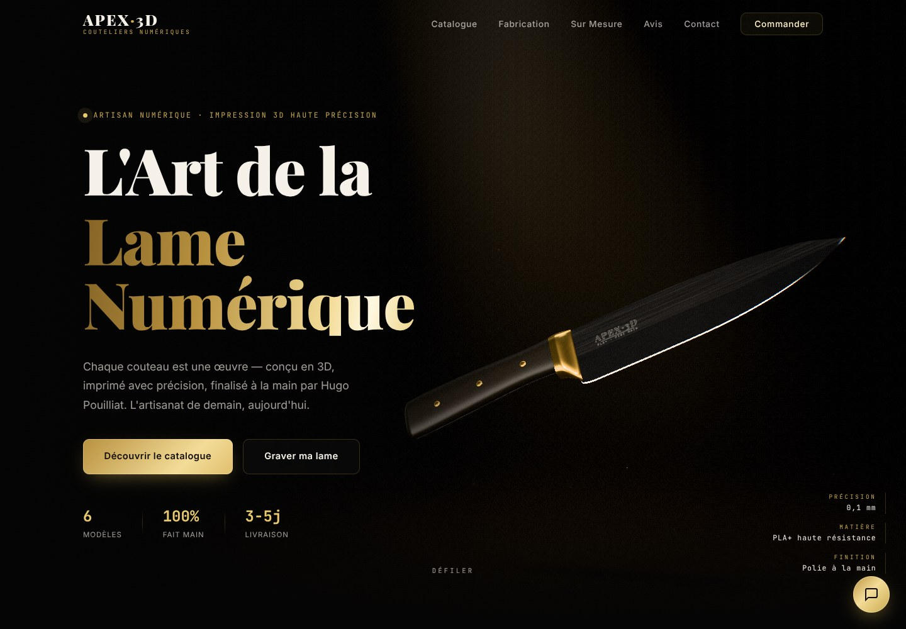
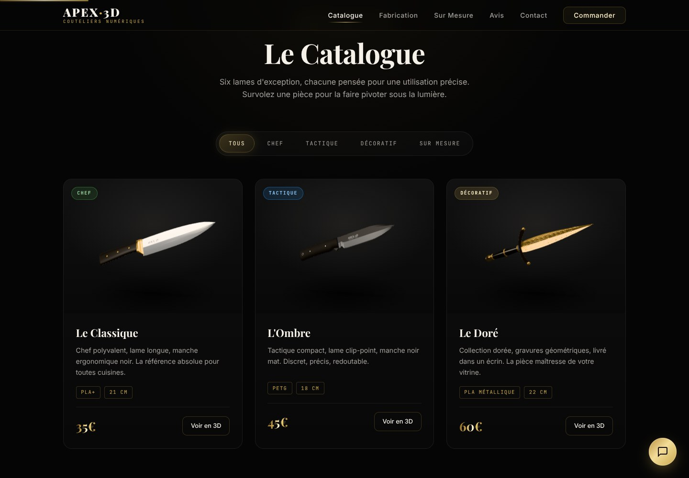
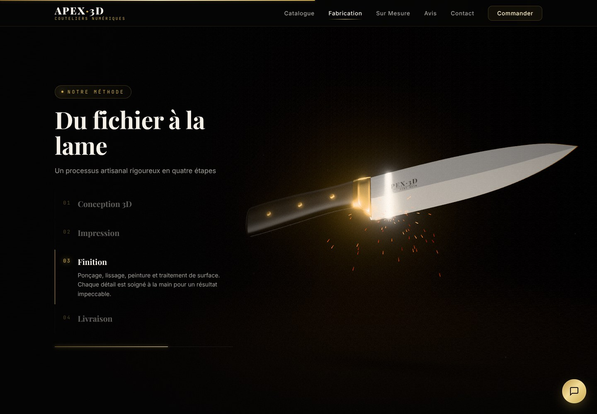
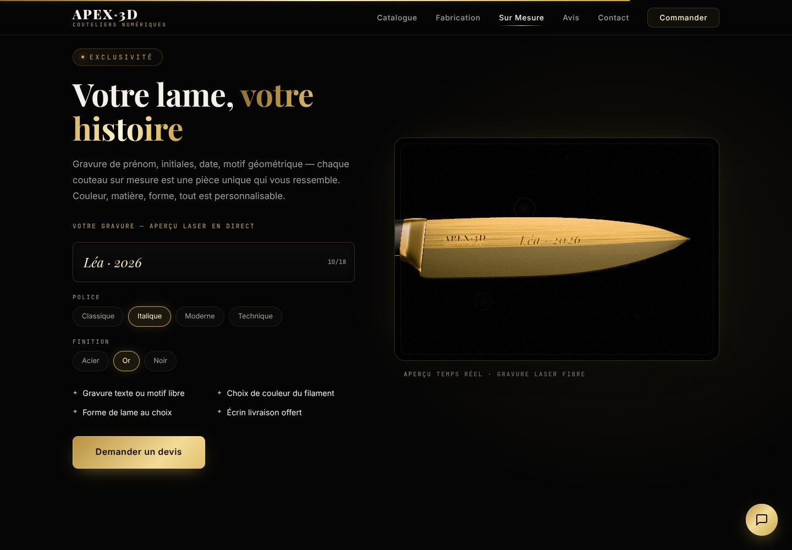

# Apex 3D

Site vitrine en HTML, CSS et JavaScript présentant un catalogue de couteaux imprimés en 3D, le processus de fabrication et une offre sur mesure. La page principale crédite Hugo Pouilliat pour la marque et les créations présentées.

Les couteaux sont rendus en 3D temps réel (WebGL2) : géométrie générée par le code, matériaux physiques (PBR) et éclairage de studio photo. Aucun modèle 3D ni aucune image produit n'est téléchargé.

## Aperçu









Pages du site exécuté localement. Le catalogue est une interface statique ; ces captures ne démontrent pas un paiement ou une commande traitée par un serveur.

## Fonctionnalités

- **Hero** : le couteau se matérialise par fusion laser couche par couche (front incandescent, gerbe d'étincelles), puis flotte au-dessus d'un sol laqué réfléchissant, dans un faisceau de lumière poussiéreux. Les reflets suivent la souris.
- **Catalogue** : six modèles 3D distincts (chef, tactique clip-point, dague dorée gravée art déco, santoku damas à alvéoles, survie à scie, hologramme « sur mesure »), animés au survol, filtres animés.
- **Fiche produit** : visionneuse 360° (glisser, molette, flèches du clavier) avec inertie.
- **Du fichier à la lame** : séquence pilotée par le défilement — plan holographique coté, impression couche par couche avec tête d'imprimante, polissage, dépose dans un écrin velours.
- **Atelier sur mesure** : le texte saisi est gravé en direct sur la lame (police et finition acier / or / noir au choix), puis pré-remplit la demande de devis.
- Formulaire de contact, assistant de conversation côté navigateur, navigation clavier et lecteurs d'écran.

## Rendu 3D

- **Lames paramétriques** : profils dos/tranchant, émouture réelle (biseau, micro-fil, contre-tranchant, gouttière) avec arêtes nettes, crantage et scie ; manches balayés en superellipse ou octogone (`js/engine/geometry.js`, `js/engine/knives.js`).
- **Matériaux** : acier brossé anisotrope, revêtement noir, or, laque, bois, G10, caoutchouc ; textures procédurales (damas, stonewash, gravures, logo) générées en canvas au chargement.
- **Lumière** : boîtes à lumière HDR captées dans une carte d'environnement préfiltrée (PMREM), comme en photo produit.
- **Extension de shader** : plan d'impression et section en fusion, lignes de couches, front de polissage, éclat sur le fil, gravure laser.
- **Post-traitement** : bloom HDR, tone mapping neutre, grain argentique, vignettage, légère aberration chromatique.
- **Deux contextes WebGL seulement** : un contexte « cinéma » déplacé dans la section la plus visible (hero, fabrication, atelier, fiche) et un contexte hors écran (`OffscreenCanvas`) qui transfère chaque carte sans copie (`transferToImageBitmap`).
- **Qualité adaptative** : résolution réduite automatiquement si le GPU peine ; rendu suspendu hors écran.

## Accessibilité et repli

- Sans WebGL2 : illustrations vectorielles et séquence de fabrication statique.
- `prefers-reduced-motion` : poses fixes, sans animation automatique.
- Sans JavaScript : tout le contenu reste lisible.

## Sécurité

- Aucun script tiers à l'exécution : three.js r186 est servi depuis `vendor/three/` (provenance et empreintes dans [vendor/three/README.md](vendor/three/README.md)).
- Politique CSP stricte (`script-src 'self'` + empreintes SHA-256 des deux scripts en ligne, `object-src 'none'`, `base-uri 'self'`).
- Aucun gestionnaire d'évènement en ligne ; le texte saisi dans l'assistant est inséré en `textContent`.

Après modification d'un script en ligne de `index.html` (détection initiale, import map), recalculer son empreinte et la reporter dans la balise CSP :

```bash
python3 -c "import re,hashlib,base64;s=open('index.html').read();[print(\"'sha256-%s'\"%base64.b64encode(hashlib.sha256(x.encode()).digest()).decode()) for x in re.findall(r'<script(?![^>]*src=)[^>]*>(.*?)</script>',s,re.S)]"
```

## Technologies

HTML5, CSS3 et JavaScript (modules ES) sans framework ni étape de compilation ; three.js pour WebGL2. Les polices sont chargées depuis Google Fonts. Aucun service de paiement ou backend de commande n’est fourni dans ce dépôt.

## Lancer localement

Les modules ES ne se chargent pas en `file://` : servir le dossier en HTTP.

```bash
git clone https://github.com/Vincent-P-essy/Apex_3D.git
cd Apex_3D
python3 -m http.server 8000
```

Ouvrir <http://localhost:8000>.

## Structure

- `index.html` : site Apex 3D.
- `styles.css` : mise en page, effets et styles responsive.
- `script.js` : interface (chargement, filtres, fiche produit, formulaires, assistant).
- `chatbot.js` : base de réponses de l'assistant.
- `js/main.js` : démarrage du rendu 3D et boucle d'animation.
- `js/stage.js` : contexte WebGL partagé entre les sections, post-traitement, qualité adaptative.
- `js/gallery.js` : rendu hors écran des cartes du catalogue.
- `js/scenes/` : hero, séquence de fabrication, atelier de gravure, visionneuse 360°.
- `js/engine/` : géométrie, modèles, matériaux, textures procédurales, éclairage, effets.
- `vendor/three/` : three.js r186 (MIT).
- `portfolio.html` : page de portfolio également conservée dans le dépôt.
